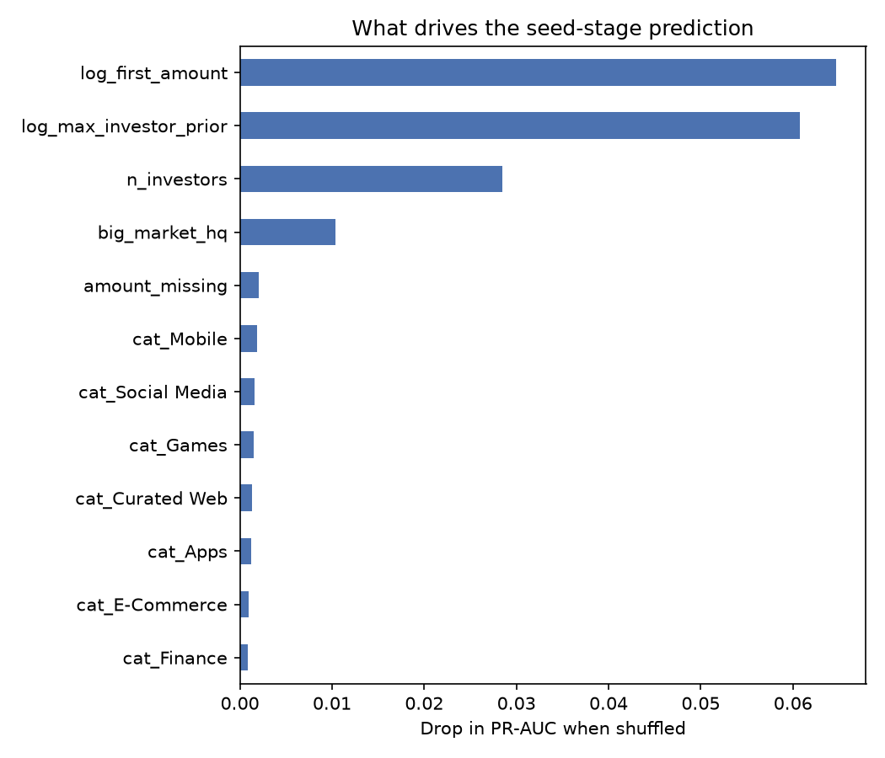

# Startup success model

This repository is an experiment in pre-reading early-stage startups. It has two parts.

1. **A baseline prediction model.** It is trained on historical public funding data and asks how much seed-stage information alone can tell us about a company's later success.
2. **A deck-scoring tool with a human in the loop.** It reads a pitch deck, drafts scores against a 16-point rubric, and gives a person a list of claims to verify and questions to ask before recommending whether to take a meeting.

The rubric follows the criteria in the essay [How venture capital actually works](https://iressa8655.github.io/digital-garden/Ventures/How-venture-capital-actually-works). It is a personal research project. It is not affiliated with, and contains no data from, any fund.



---

## 1. What data the model is trained on

### 1.1 Source

The model uses the public Crunchbase export mirrored at [notpeter/crunchbase-data](https://github.com/notpeter/crunchbase-data). It is a snapshot taken in **2015**. The data is not redistributed in this repository, and `scripts/download_data.sh` fetches it into `data/raw/`.

| File | Rows (approx.) | One row is |
|---|---|---|
| `companies.csv` | 66,000 | A company, with its category, country, status (operating, closed, acquired, IPO) and total funding |
| `rounds.csv` | 115,000 | A funding round, with its type (seed, angel, venture…), series code (A, B…), date and amount |
| `investments.csv` | 169,000 | One investor taking part in one round |
| `acquisitions.csv` | 19,000 | An acquisition. It is downloaded but not yet used. |

The row counts are from `wc -l` on the downloaded files, minus the header line.

### 1.2 Cohort

The model only studies companies whose **first recorded round was seed or angel, dated 2007 to 2011**. That gives **7,038 companies**, and the 2015 snapshot leaves each of them at least three to four years for an outcome to appear.

### 1.3 Label, what "success" means here

A company is labelled a success (`1`) if, by the 2015 snapshot, it either

- raised a round coded Series B or later, or
- has the status `acquired` or `ipo`.

**19.2%** of the cohort meets this definition.

> This is a much lower bar than the venture definition of success, which is an outcome large enough to return a whole fund. Billion-dollar outcomes are too rare in this cohort to learn from, so this proxy is used instead.

### 1.4 Features, only what was known at the first round

To avoid leakage, every feature uses only information available on the date of the first round.

| Feature | Meaning |
|---|---|
| `log_first_amount`, `amount_missing` | Size of the first round, log-scaled, plus a flag when it is missing |
| `is_angel` | Angel round versus seed |
| `first_year` | Year of the first round |
| `big_market_hq` | Headquarters in the US, UK, Germany or France |
| `cat_*` | The company's primary category, as one-hot columns for the 15 most common categories plus "Other" |
| `n_investors` | Number of investors in the first round |
| `log_max_investor_prior` | The most experienced investor's number of deals **before** that date, a proxy for investor quality |

**Not included.** There is no founder information at all, because the export has no people data. A check against Wikidata found founders listed for only 2–5% of the cohort, and the coverage was skewed towards successful companies, so it was left out to avoid leaking the outcome.

### 1.5 Training and evaluation

- The split is by time. The model trains on 2007–2010 cohorts and is tested on the 2011 cohort.
- There are two models, a logistic regression and gradient-boosted trees (scikit-learn).
- PR-AUC is the main metric, because successes are the minority class.

| Model | ROC-AUC | PR-AUC |
|---|---|---|
| Random guess | 0.50 | 0.15 |
| Logistic regression | 0.753 | 0.362 |
| Gradient-boosted trees | 0.728 | 0.324 |

The strongest features are the size of the first round and the track record of its investors. In other words, the model mostly learns *other investors' judgement*, which is self-reinforcing. A well-known investor makes the next round easier to raise.

### 1.6 Known limitations

- **The data is old.** It stops in 2015, and the AI startup landscape looks very different now.
- **Survivorship bias.** Companies that failed quietly are often missing from Crunchbase.
- **Proxy label.** Reaching Series B or an exit is not the same as becoming an outlier.
- **No team, market-ambition or moat signal.** These are the criteria investors weigh most, which is why the second part of this repository puts a human in the loop.

---

## 2. The deck-scoring tool

```
deck.pdf ──► deck_reader.py ──► draft scores (all "claimed")
                                     │
                         human verifies each claim
                         and asks the discovery questions
                                     │
                                     ▼
                deck_scorer.py ──► pillar scores + Take meeting / Maybe / Pass
                                    + list of claims still unverified
```

- **`RUBRIC.md`** defines the three pillars (outlier team, upside, moat) and 16 sub-criteria, each anchored at 1, 3 and 5.
- **`src/deck_reader.py`** extracts text from a PDF or PPTX and asks Claude to draft a score for each sub-criterion. Each draft score comes with a quote from the deck, a page number, and the record to check. Every score starts as `claimed`, because a deck is the founder's own account.
- **`src/deck_scorer.py`** applies the verification status, averages each pillar and returns a recommendation.

The human in the loop has two jobs.

1. **Fact-check.** Change each claim to `verified` or `contradicted` against an independent record, such as a publication record, commit history or company register.
2. **Discovery.** Ask what the deck leaves out, such as past failures, who sells, and what happens when the next frontier model ships.

### Usage

```bash
pip install pandas scikit-learn matplotlib tqdm pypdf python-pptx anthropic

# 1. Draft scores. Without ANTHROPIC_API_KEY, or with --dry-run, it only saves the prompt.
python src/deck_reader.py my_deck.pdf

# 2. Edit my_deck_draft_scores.json, setting each status to verified or contradicted.

# 3. Score
python src/deck_scorer.py my_deck_draft_scores.json
```

Try it on the bundled fictional example:

```bash
python src/deck_scorer.py examples/example_deck_scores.json
```

> **Confidentiality.** Founders share decks in confidence. Before you send a real deck to any external AI API, check that you have the right to do so.

---

## 3. Reproducing the model

```bash
bash scripts/download_data.sh
jupyter notebook notebooks/01_startup_success_baseline_HITL.ipynb
```

The notebook's comments are in Traditional Chinese, and its figures are in English.

## 4. Next steps

- Add founder features (publications, open-source work) from a source with unbiased coverage.
- Replace the hand-set thresholds in `src/rubric.json` with weights learned from scored decks with known outcomes.
- Move to more recent funding data.

## Licence

The code is released under MIT. The Crunchbase data is subject to its own terms, and is not included here.
